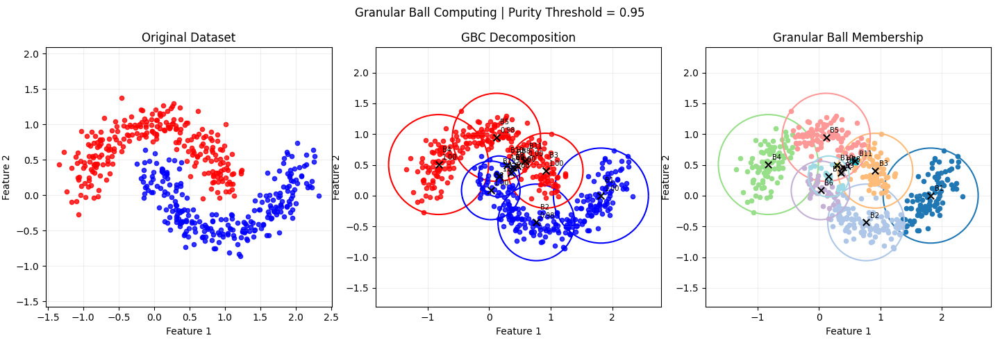

# Granular Ball Computing — Experimental Results

## 1. Experiment Overview

This experiment evaluates a basic Granular Ball Computing (GBC) implementation using the `make_moons` dataset. The dataset contains 500 samples and is recursively divided into smaller granular balls using spatial K-Means clustering.

K-Means uses only the feature coordinates during splitting. Class labels are used to calculate the purity of each resulting ball and identify its dominant class.

### Experimental Configuration

| Parameter               | Value        |
| ----------------------- | ------------ |
| Dataset                 | `make_moons` |
| Total samples           | 500          |
| Noise                   | 0.15         |
| Random state            | 42           |
| Purity threshold        | 0.95         |
| Minimum child size      | 1            |
| Maximum recursion depth | 100          |
| Clustering algorithm    | K-Means      |
| Clusters per split      | 2            |

## 2. Overall Results

| Metric                                     | Result  |
| ------------------------------------------ | ------- |
| Dataset samples                            | 500     |
| Final granular balls                       | 12      |
| Class 0 (Red) samples                      | 250     |
| Class 1 (Blue) samples                     | 250     |
| Balls reaching membership-purity threshold | 12 / 12 |
| Sample-assignment verification             | Passed  |
| Boundary verification                      | Passed  |

## 3. Individual Granular Ball Results

| Ball  | Samples | Class 0 (Red) | Class 1 (Blue) | Dominant class | Membership purity | Radius | Status         |
| ----- | ------- | ------------- | -------------- | -------------- | ----------------- | ------ | -------------- |
| 1     | 95      | 0             | 95             | Blue           | 1.0000            | 0.7720 | Purity reached |
| 2     | 104     | 2             | 102            | Blue           | 0.9808            | 0.6222 | Purity reached |
| 3     | 63      | 63            | 0              | Red            | 1.0000            | 0.6086 | Purity reached |
| 4     | 87      | 87            | 0              | Red            | 1.0000            | 0.8115 | Purity reached |
| 5     | 96      | 94            | 2              | Red            | 0.9792            | 0.7155 | Purity reached |
| 6     | 30      | 0             | 30             | Blue           | 1.0000            | 0.4755 | Purity reached |
| 7     | 1       | 0             | 1              | Blue           | 1.0000            | 0.0000 | Purity reached |
| 8     | 1       | 1             | 0              | Red            | 1.0000            | 0.0000 | Purity reached |
| 9     | 1       | 0             | 1              | Blue           | 1.0000            | 0.0000 | Purity reached |
| 10    | 1       | 0             | 1              | Blue           | 1.0000            | 0.0000 | Purity reached |
| 11    | 3       | 3             | 0              | Red            | 1.0000            | 0.0500 | Purity reached |
| 12    | 18      | 0             | 18             | Blue           | 1.0000            | 0.3328 | Purity reached |
| Total | 500     | 250           | 250            | —              | —                 | —      | —              |

All 12 balls reached the configured membership-purity threshold of 0.95. Balls 2 and 5 contain two samples from the non-dominant class; the other ten balls have membership purity of 1.0000.

## 4. Membership-Purity Verification

Membership purity is calculated using the class labels of the samples assigned to a granular ball:

```
Membership_Purity(B_i) = max(n_i_0, n_i_1) / (n_i_0 + n_i_1)
```

Where:

- `B_i` is the i-th granular ball.
- `n_i_0` is the number of Class 0 samples assigned to the ball.
- `n_i_1` is the number of Class 1 samples assigned to the ball.

The verification output was:

```
PURITY VERIFICATION
=======================================================
All granular balls reached the purity threshold.
```

All 12 granular balls satisfy the configured membership-purity threshold of 0.95.

## 5. Sample-Assignment Verification

This check verifies that every original dataset sample is assigned to exactly one final granular ball. It checks that there are no missing or duplicated sample assignments.

```
SAMPLE ASSIGNMENT VERIFICATION
=======================================================
Every sample assigned exactly once: True
```

The verification passed: all 500 samples were assigned exactly once.

## 6. Granular-Ball Boundary Verification

Each granular ball is represented by a centre and an enclosing radius.

The centre is the mean position of its assigned samples:

```
Centre(B_i) = Sum of all sample coordinates assigned to B_i
              / Number of samples assigned to B_i
```

The radius is the greatest Euclidean distance from the centre to any assigned sample:

```
Radius(B_i) = Maximum Euclidean distance between:
              - Each sample assigned to B_i
              - The centre of B_i
```

The boundary check counts assigned samples that fall outside their ball's circle.

| Ball  | Assigned points outside boundary |
| ----- | -------------------------------- |
| 1     | 0                                |
| 2     | 0                                |
| 3     | 0                                |
| 4     | 0                                |
| 5     | 0                                |
| 6     | 0                                |
| 7     | 0                                |
| 8     | 0                                |
| 9     | 0                                |
| 10    | 0                                |
| 11    | 0                                |
| 12    | 0                                |
| Total | 0                                |

```
BOUNDARY VERIFICATION
=======================================================
All assigned samples are contained within their respective boundaries.
```

No assigned sample was outside its corresponding granular ball.

Interpretation: Because the radius is defined as the maximum distance from the centre to any assigned sample, all assigned samples are expected to lie within the resulting circle (subject to the numerical tolerance used in the code). This check confirms consistency between the radius calculation and the assigned points; it is not an independent test of the quality of the partition.

## 7. Geometric-Purity Verification

Membership purity considers only the samples assigned to a particular granular ball. However, the enclosing circle can also contain samples assigned to other balls.

Geometric purity is therefore calculated using every dataset sample whose coordinates lie inside the circle, regardless of its assigned ball:

```
Geometric_Purity(B_i) = max(red_inside, blue_inside)
                        / (red_inside + blue_inside)
```

Where:

- `n_inside_i_0` is the number of Class 0 samples geometrically inside the ball.
- `n_inside_i_1` is the number of Class 1 samples geometrically inside the ball.
- `red_inside` represents the number of Class 0 samples inside the ball.
- `blue_inside` represents the number of Class 1 samples inside the ball.

### Geometric-Purity Results

| Ball | Assigned samples | Geometrically inside | Red inside | Blue inside | Membership purity | Geometric purity |
| ---- | ---------------- | -------------------- | ---------- | ----------- | ----------------- | ---------------- |
| 1    | 95               | 119                  | 9          | 110         | 1.0000            | 0.9244           |
| 2    | 104              | 115                  | 9          | 106         | 0.9808            | 0.9217           |
| 3    | 63               | 88                   | 84         | 4           | 1.0000            | 0.9545           |
| 4    | 87               | 117                  | 107        | 10          | 1.0000            | 0.9145           |
| 5    | 96               | 137                  | 115        | 22          | 0.9792            | 0.8394           |
| 6    | 30               | 60                   | 0          | 60          | 1.0000            | 1.0000           |
| 7    | 1                | 1                    | 0          | 1           | 1.0000            | 1.0000           |
| 8    | 1                | 1                    | 1          | 0           | 1.0000            | 1.0000           |
| 9    | 1                | 1                    | 0          | 1           | 1.0000            | 1.0000           |
| 10   | 1                | 1                    | 0          | 1           | 1.0000            | 1.0000           |
| 11   | 3                | 4                    | 4          | 0           | 1.0000            | 1.0000           |
| 12   | 18               | 39                   | 0          | 39          | 1.0000            | 1.0000           |

### Observations

- Balls 1, 2, 4 and 5 have geometric purity below 0.95, even though their membership purity meets the threshold.
- Ball 5 has the lowest geometric purity, at 0.8394, despite membership purity of 0.9792.
- Ball 3 has geometric purity of 0.9545, above the 0.95 threshold.
- Balls 6–12 have geometric purity of 1.0000.

This difference occurs because the enclosing circles can contain points assigned to other granular balls. The assigned membership of a ball and the complete set of points inside its geometric boundary are therefore not necessarily the same.

## 8. Visualisation

The figure below should be stored in the same directory as this Markdown file and named `figure.png`.



Figure 1. Original dataset, GBC decomposition and granular-ball membership visualisation.

## 9. Discussion

The experiment generated 12 granular balls from the original dataset of 500 samples. Every final ball reached the membership-purity threshold of 0.95. Sample-assignment verification confirmed that each sample was assigned exactly once, and boundary verification confirmed that every assigned sample was enclosed by its corresponding circle.

The geometric-purity analysis shows that membership purity does not necessarily describe the class composition of the entire geometric region. For example, Ball 5 has membership purity of 0.9792 but geometric purity of 0.8394. Its enclosing circle contains additional samples assigned to other granular balls, including samples from the other class.

The experiment also produced several very small balls. Balls 7–10 each contain one sample and have a radius of zero. These balls meet the purity threshold trivially. This is consistent with the configured minimum child size of one, which permits singleton granular balls.

Two useful directions for subsequent experiments are:

1. Investigate whether splitting or stopping criteria should consider geometric purity as well as membership purity.
2. Test a larger minimum child size to assess whether it reduces singleton granular balls and how that affects purity and the final number of balls.

## 10. Conclusion

The initial GBC implementation successfully decomposed the 500-sample `make_moons` dataset into 12 granular balls using recursive spatial K-Means clustering.

All 12 balls achieved membership purity of at least 0.95. Sample-assignment and boundary verification both passed.

However, geometric purity was lower than membership purity for four balls. This demonstrates that a ball can have highly pure assigned membership while its enclosing circle also contains samples belonging to another class.

These results provide a baseline for further experiments involving geometric purity, alternative splitting criteria and minimum granular-ball size.